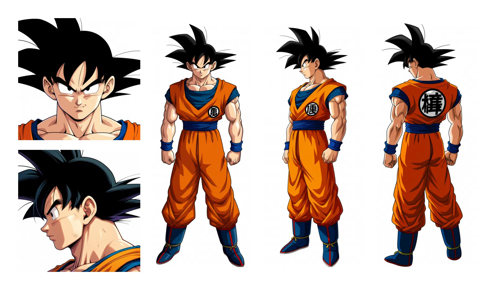
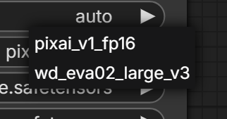
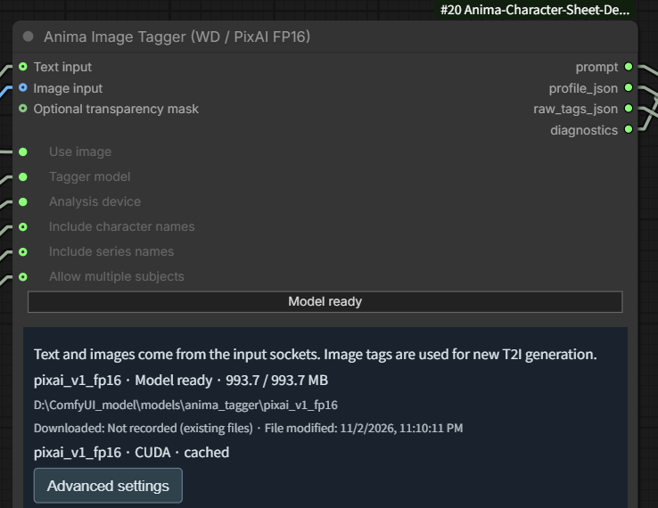
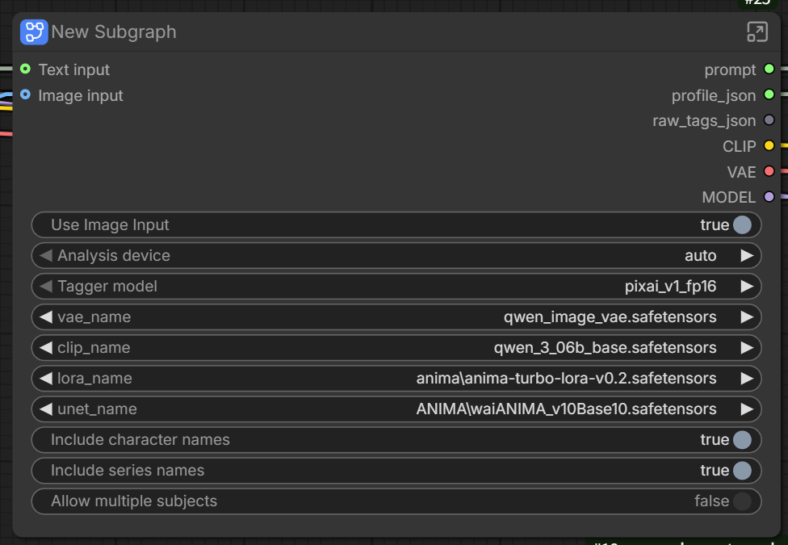
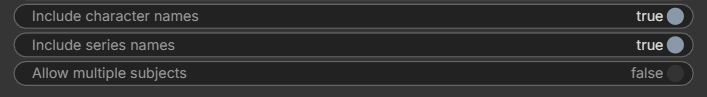
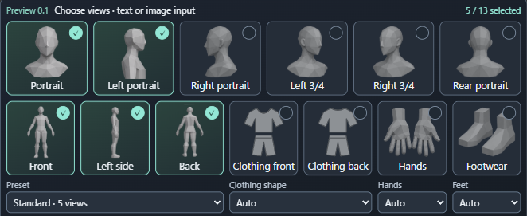
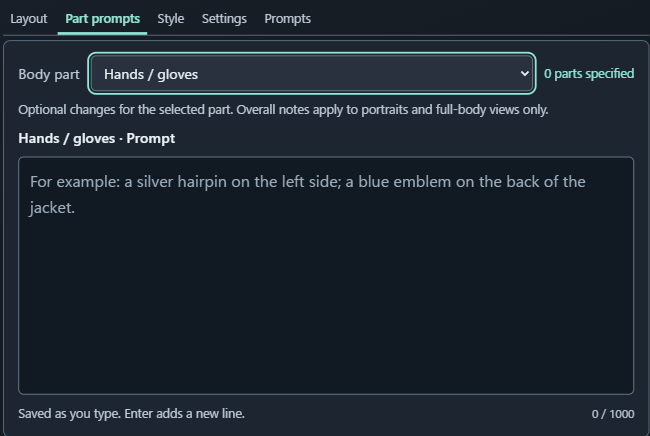
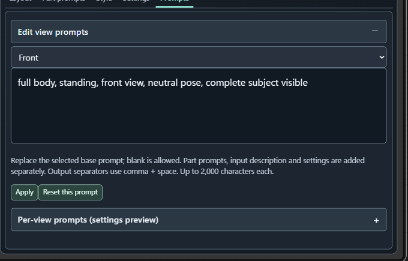
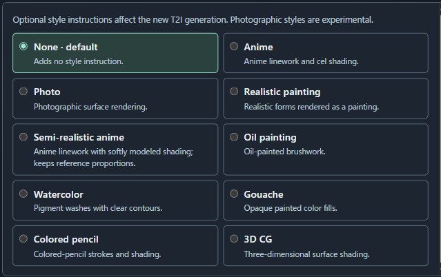
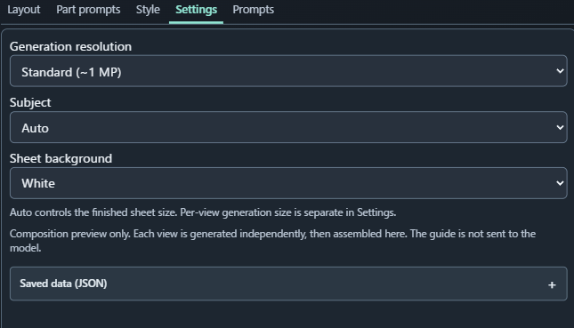

# Anima Character Sheet Designer — v1.0

[English](README.md) · [v1.0ダウンロード](https://github.com/ukr8b3g-cmyk/Anima-Character-Sheet-Designer/releases/tag/v1.0) · [ワークフロー](examples/Anima-Character-Sheet-Designer-Text-or-Image.json)

ComfyUIで **Anima用のキャラクターシート** を作成します。最大 **13ビューを個別生成して1枚へ合成**。テキスト入力と、**PixAI Tagger v1.0 FP16／WD EVA02 Large v3** による画像のタグ解析を切り替えられます。

シートの操作は作者の [MOSS-Image版](https://github.com/ukr8b3g-cmyk/MOSS-Image-Character-Sheet-Designer)、[H3版](https://github.com/ukr8b3g-cmyk/H3-Character-Sheet-Designer)、[Qwen-Image 2.1版](https://github.com/ukr8b3g-cmyk/Qwen-Image-2.1-Character-Sheet-Designer) を基にしています。Anima版では **各ビューの内部プロンプトをPromptsタブで確認・編集** できます。



## 重要：画像入力でも新しいT2I画像を生成します

**入力画像 → ローカルTagger → 外観タグ → Animaで各ビューを新規T2I生成 → シートへ合成**

H3版・Qwen版のように元画像を描画モデルへ直接参照させたり、画素を編集したりする方式ではありません。MOSS版の「画像を文章化してから生成」に近く、Anima版では **タグ** を使います。以前のRef Adapter経路は使いません。

顔・衣装・色・装飾・画像に写っていない背面などは変わる場合があります。キャラクター名・作品名のタグから既知の衣装へ引っ張られる場合もあります。元画像の忠実な再現を保証するものではありません。

## インストール・ワークフローの読込

1. `ComfyUI/custom_nodes` で次を実行します。

   ```bash
   git clone https://github.com/ukr8b3g-cmyk/Anima-Character-Sheet-Designer.git
   ```

2. 不足している場合は **ComfyUIのPython環境** に `requirements.txt` の依存を入れます。画像解析にはCPU用の `onnxruntime`、またはCUDAに対応した `onnxruntime-gpu` も必要です。両方は入れず、環境に合う片方を使ってください。ノードがPython依存を自動導入することはありません。
3. 付属ワークフロー用の [Save WEBP Meta](https://github.com/ukr8b3g-cmyk/ComfyUI-save-webp-meta-node) を導入します。LoRA読込は標準ノードです。rgthree・Anima Ref Adapterは不要です。
4. 下表の生成用モデルを導入します。インストール・更新後はComfyUIを再起動し、ブラウザーを再読込します。
5. `examples` のJSON、またはReleaseの **Workflow-v1.0.zip** を開きます。ZIPには提供されたサンプル画像も入っています。標準の **Load Image** でサンプルか自分の画像を読み込んでください。JSONの隣に画像を置くだけではComfyUIのinputフォルダーには登録されません。

Anima・サブグラフに対応する新しいComfyUIを使ってください。ローカル検証はComfyUI0.43.0／frontend1.57.4です。標準・利用者指定のノード名を保持し、付属サブグラフの操作項目は英語／日本語ロケールへ追従します。

### 生成用モデル

標準テンプレートは **WAI-ANIMA v1.0（base1.0）＋Anima Turbo LoRA v0.2** です。下記のサブフォルダーへ置くか、入力・モデル側サブグラフで導入済みのファイル名へ合わせます。

| テンプレートの生成用ファイル | 配布元 | ComfyUI/models内 |
|---|---|---|
| ANIMA/waiANIMA_v10Base10.safetensors | [WAI-ANIMA v1.0](https://civitai.com/models/2544636?modelVersionId=2983680) | diffusion_models |
| qwen_3_06b_base.safetensors | [Anima TE](https://huggingface.co/circlestone-labs/Anima/resolve/main/split_files/text_encoders/qwen_3_06b_base.safetensors) | text_encoders |
| qwen_image_vae.safetensors | [Anima VAE](https://huggingface.co/circlestone-labs/Anima/resolve/main/split_files/vae/qwen_image_vae.safetensors) | vae |
| anima/anima-turbo-lora-v0.2.safetensors | [Turbo v0.2](https://civitai.com/models/2560840?modelVersionId=2979642) | loras |

初期設定は **LoRA0.7・10ステップ・CFG1.5・Euler／simple**、CLIP typeは `stable_diffusion`。テンプレートはWebP品質70で保存します。提供されたワークフローの開始設定で、すべてのモデル・キャラクターに最適とは限りません。

### Taggerモデル：手動配置か、内部ノードの取得ボタン

**収録データ・タグの新しさを重視し、PixAI v1.0 FP16を推奨・既定** としています。[PixAI v1.0公式](https://huggingface.co/pixai-labs/pixai-tagger-v1.0)の収録範囲は2026年5月まで、[WD EVA02 Large v3](https://huggingface.co/SmilingWolf/wd-eva02-large-tagger-v3)のタグは2024年2月28日までです。**従来のWD方式のタグ付けや、その結果の傾向を好む場合はWD EVA02 Large v3** を選んでください。使うTaggerだけ導入できます。上表の生成用モデルとは別です。



取得方法はどちらか一方を選びます。

- **手動配置：** 下表の該当行の全ファイルを取得し、名前を変えずに `ComfyUI/models/anima_tagger`（共有モデル設定がある場合はその場所）の指定フォルダーへ置きます。
- **ワークフロー内から取得：** 入力・モデル側サブグラフの右上矢印で内部へ入り、**Anima Image Tagger** を開きます。Tagger modelで選び、**Download selected model／選択モデルをダウンロード** を押します。**選択中の1モデルだけ** 取得します。進捗・検証・保存先・準備状態が表示されます。frontend1.57.4では取得ボタンを親サブグラフへ昇格できないため、内部で操作します。



画像の **Model ready／モデル準備完了** は、選択モデルが取得済みという意味です。未導入時にはダウンロード操作が表示されます。ワークフローを開くだけでは取得しません。固定版の容量・SHA-256を検査し、不一致ファイルは上書きしません。取得日時の記録がある場合は表示し、ファイル更新日時とは区別します。画像解析はローカルで行います。

モデルを手動配置・移動・修復した後は、Tagger内の **Check model files／モデルファイルを再確認** を押します。ダウンロードや生成をせず、選択モデルを再検査します。ワークフロー読込時・モデル切替時も再確認し、通常の状態問い合わせでは完了済み検査を最大5秒間再利用します。

| Tagger | 必要ファイル（直接リンク） | models/anima_tagger内のフォルダー |
|---|---|---|
| **PixAI v1.0 FP16：推奨・既定** | [model_fp16.onnx](https://huggingface.co/Mexes/pixai-tagger-v1.0-onnx-fp32-fp16-int8/resolve/0800778563144a0e6fdf41ddadd84aae3cb0dbcf/model_fp16.onnx)（992,916,002バイト）、[selected_tags.csv](https://huggingface.co/Mexes/pixai-tagger-v1.0-onnx-fp32-fp16-int8/resolve/0800778563144a0e6fdf41ddadd84aae3cb0dbcf/selected_tags.csv)、[preprocess.json](https://huggingface.co/Mexes/pixai-tagger-v1.0-onnx-fp32-fp16-int8/resolve/0800778563144a0e6fdf41ddadd84aae3cb0dbcf/preprocess.json) | pixai_v1_fp16 |
| WD EVA02 Large v3 FP32：代替 | [model.onnx](https://huggingface.co/SmilingWolf/wd-eva02-large-tagger-v3/resolve/b25b82a03f7282e41aa2f257a52c7583b710bd1c/model.onnx)（1,260,435,999バイト）、[selected_tags.csv](https://huggingface.co/SmilingWolf/wd-eva02-large-tagger-v3/resolve/b25b82a03f7282e41aa2f257a52c7583b710bd1c/selected_tags.csv) | wd_eva02_large_v3 |

CSVはモデルの出力番号とタグ名を対応付ける専用辞書です。重みと同じ配布元のものを使い、タグ補完用の別辞書へ置き換えないでください。PixAIは [公式v1.0](https://huggingface.co/pixai-labs/pixai-tagger-v1.0) を [Mexes氏がONNXへ変換したFP16版](https://huggingface.co/Mexes/pixai-tagger-v1.0-onnx-fp32-fp16-int8) です。FP8ではありません。INT8は廃止済みです。重みは拡張へ同梱しません。

## 基本操作：テキスト／画像の切替



| Use Image Input | 動作 |
|---|---|
| **true／ON** | 標準Load Image → Taggerで外観タグ抽出 → 新規T2Iシート生成。接続した手動テキストは使いません。 |
| **false／OFF** | 接続したString (Multiline)の文章 → 新規T2Iシート生成。画像解析・Tagger重みは不要です。 |

テキストでは1被写体の外観を記述します。顔、該当する場合の髪、衣装・色・装飾などを中心にします。品質タグが必要なら利用者が入力します。自動の品質接頭辞やネガティブ出力はありません。ネガティブは描画側サブグラフ内の通常の **CLIP Text Encode** で編集します。

画像を使わない場合はLoad Imageの接続を外してください。画像OFFでも、接続した画像ファイル名はComfyUIの事前検証を受けます。画像モードでは、対象を中心にクロップすると背景や別人物の混入を減らせる場合がありますが、切り取った範囲外の特徴は読み取れません。

**Analysis device／解析デバイス：** `auto` はCUDAを優先し、GPU環境を使えない場合は同じ選択モデルでCPUへ切り替えます。`cpu` はCPU指定、`cuda` は動作するCUDAプロバイダーが必須です。AutoがPixAIとWDを切り替えることはありません。詳細設定には採用スコア（高いほど少数の確度の高いタグに絞る）、rawタグ除外、部位別追加などがあります。まず初期値から始められます。



- **Include character names／キャラクター名を採用：** 検出した名前を顔・全身ビューへ追加します。認識しやすくなる一方、既知の衣装が混ざる場合もあります。
- **Include series names／作品名を採用：** 対応モデルの作品タグを追加します。WDには作品名の専用分類がありません。
- **Allow multiple subjects／複数の被写体を許可：** 複数被写体の解析を許可します。特徴が混ざるため、通常の1キャラクター用ではOFFを推奨します。

付属テンプレートは名前・作品名ON、複数被写体OFFです。単独で新規追加したTaggerは3項目ともOFFです。アーティスト・画風タグは生成文へ自動採用しません。出力内容は **Preview Any** へ接続して確認できます。

## シートデザイナーの操作

### Layout：ビューと配置



直接ビューを選ぶか、Standard5・Basic4・Turnaround3・Single・7ビュー・Head6・衣装前後・All13から選びます。Clothing shape、Hands、Feetは関連ビューの指定を調整します。

衣装型・手・履物を明示すると、対応ビューで設定に反する自動外観タグを除外します。**Auto** は重ね着も含め、抽出した衣装を保持します。手動入力文・Part prompts・追加タグ・元の解析結果は保持します。生成を誘導する指定であり、衣装や向きの完全な再現を保証するものではありません。

**Auto／Manualの出力サイズは完成シートの寸法** です。各ビューを別々に生成してAssembleで配置します。人形のガイドは合成配置のプレビューで、Animaへ送りません。掲載画面は開発中に提供されたもので、製品ノードの版表示はv1.0です。

### Part prompts：部位への追加指示



部位を選び、例えば **Footwearに `black boots`**、**Hands / glovesに `fingerless gloves`** と入力します。関連する選択ビューへ **追加** する外観指示です。ビューの内部プロンプトを置き換える欄ではありません。Overall / otherは顔・全身ビューに適用します。入力しながら保存されます。

### Prompts：内部のビュー文を確認・置換



Anima版の大きな違いです。**Prompts → Edit view prompts** を開き、ビューを選んで基本文を編集し、**Apply** で反映します。**Reset this prompt** でそのビューの初期文へ戻せます。空欄への置き換えもできます。

例えばFrontは `full body, standing, front view, neutral pose, complete subject visible` のように、画角や向きを指定する文です。入力した外観・関連するPart prompts・設定は別途追加されます。短い句を **コンマ＋スペース** で区切ってください。設定プレビューは接続入力や実行seedを含まず、実際のビュー別最終文は `view_records` で確認できます。

### Style・Settings



**None** はスタイル指示を追加しません。他の選択肢は描画方向を追加します。Animaはイラスト向けモデルのため、写真系スタイルは実験的です。



- **Generation resolution：** 各ビューを描画する解像度。上げると細部改善が期待できる一方、時間・VRAMが増えます。完成シートだけ拡大しても顔の細部は増えません。
- **Subject：** Auto、または生成ビューの被写体分類を指定します。
- **Sheet background：** 合成シートの背景色です。
- **Saved data (JSON)：** 保存設定の確認・編集用です。通常は触る必要がありません。

## 制約・確認状況

個別生成のため、ビュー間で顔・衣装・左右の向き・細部が変わる場合があります。衣装だけの欄に人物やマネキンが残る、背面が正面になる、元画像にない特徴を創作するといった制約があります。特に13ビューは生成後に目視確認してください。タグ解析でも元画像の忠実な再現は保証できません。

入力文は4,000 Unicodeコードポイント／16,000 UTF-8バイト、部位指示は1,000、各ビューの基本文は2,000コードポイントが上限です。保存state／configは64KiB。Manualの完成寸法は導入済み環境の上限内かつ最大16,777,216画素です。Animaのトークン上限とは別の、本拡張の制限です。

ローカルで **Python39件＋JavaScript18件**、実画面の日英切替・保存再読込・API配線の完全一致を確認。提供されたサンプルは1回の実測で5ビュー・1824×1072・44.3秒のWebPを生成しました。髪の端の切れや向き・細部の揺れは残ります。1画像・1seedの結果で、汎用的な品質・速度保証ではありません。[変更履歴](CHANGELOG.md)も参照してください。

## ライセンス

オリジナルコードはMITです。画像・アートワーク・モデル・外部コンポーネントの権利・条件は別です。[LICENSE](LICENSE)／[NOTICE](NOTICE.md)を参照してください。重みは別途取得します。Comfy Registry／Manager登録は今回のGitHub公開とは別です。
