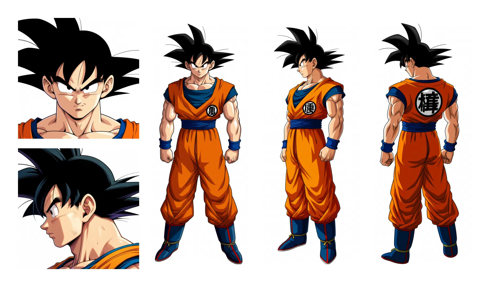
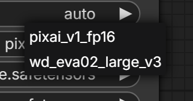
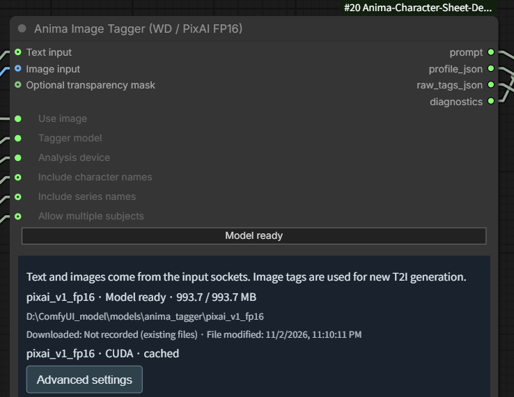
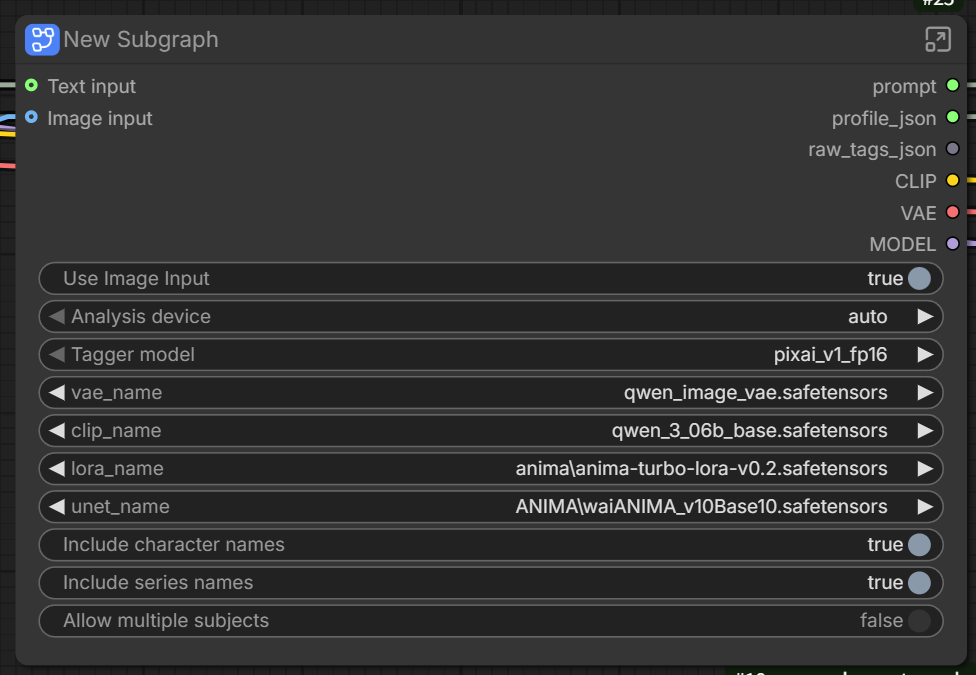
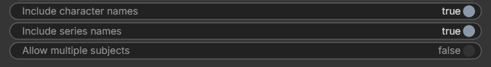
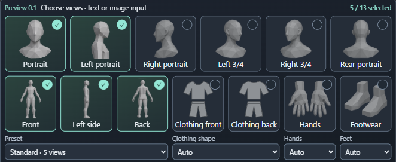
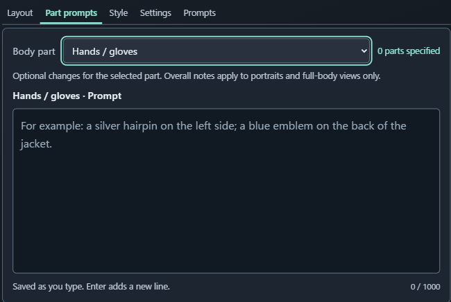
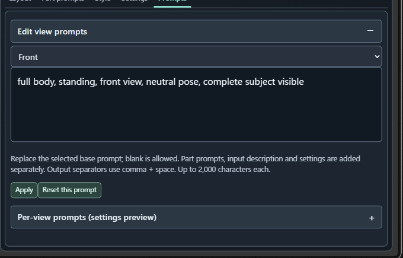
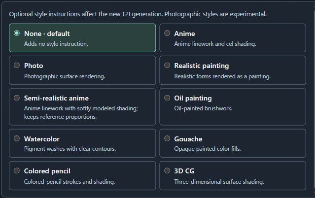
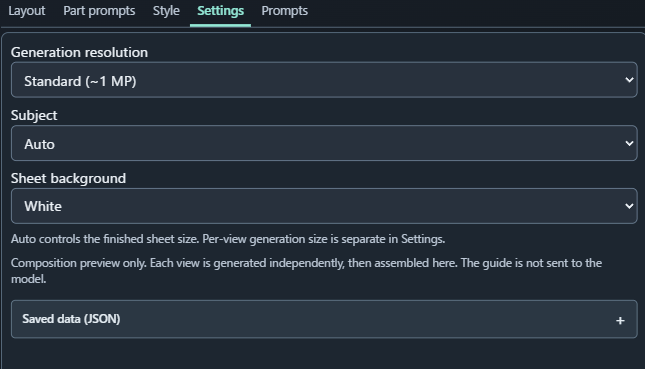

# Anima Character Sheet Designer — v1.0

[日本語](README.ja.md) · [Download v1.0](https://github.com/ukr8b3g-cmyk/Anima-Character-Sheet-Designer/releases/tag/v1.0) · [Workflow](examples/Anima-Character-Sheet-Designer-Text-or-Image.json)

Create character reference sheets with **Anima** in ComfyUI. Choose up to **13 views**, generate each view independently, then assemble them into one sheet. Use a text description or convert an image into appearance tags with **PixAI Tagger v1.0 FP16** or **WD EVA02 Large v3**.

The familiar sheet controls build on the author's [MOSS-Image](https://github.com/ukr8b3g-cmyk/MOSS-Image-Character-Sheet-Designer), [H3](https://github.com/ukr8b3g-cmyk/H3-Character-Sheet-Designer) and [Qwen-Image 2.1](https://github.com/ukr8b3g-cmyk/Qwen-Image-2.1-Character-Sheet-Designer) designers. Anima adds an editable **base prompt for every view** in the Prompts tab.



## Important: image input still produces a new T2I image

**Image → local Tagger → appearance tags → new Anima generations → assembled sheet.**

Unlike the H3 and Qwen workflows, this template does **not** pass the image to the generator as a visual reference or edit its pixels. It is closest to the MOSS version's image-to-description approach, using **tags** rather than a vision-language description. The previous Ref Adapter route is not used.

Faces, clothing, colors, accessories and unseen surfaces may differ from the source. Character/series tags can also bring a familiar costume into the result. This is not an exact image-reproduction workflow.

## Install and open the workflow

1. In your `ComfyUI/custom_nodes` folder, run:

   ```bash
   git clone https://github.com/ukr8b3g-cmyk/Anima-Character-Sheet-Designer.git
   ```

2. Using **ComfyUI's Python environment**, install `requirements.txt` if those packages are missing. Image tagging also requires either `onnxruntime` for CPU, or a compatible `onnxruntime-gpu` setup for CUDA. Use one ONNX Runtime package, not both. These Python dependencies are not installed automatically by the node.
3. Install [Save WEBP Meta](https://github.com/ukr8b3g-cmyk/ComfyUI-save-webp-meta-node), which the supplied workflow uses. The LoRA loader is a standard ComfyUI node; rgthree and Anima Ref Adapter are not required.
4. Download the generation files listed below. Restart ComfyUI and reload the browser after installation/updates.
5. Open the workflow JSON in `examples`, or download the **Workflow-v1.0.zip** asset from the release. That ZIP includes the supplied sample image; load it in the standard **Load Image** node, or choose your own image. Copying an image beside the JSON does not install it into ComfyUI's input directory.

Use a recent ComfyUI with native Anima and subgraph support. Local validation used ComfyUI 0.43.0 / frontend 1.57.4. Standard and user-assigned node titles are retained; the supplied subgraph controls follow English/Japanese locale.

### Generation models

The supplied template uses **WAI-ANIMA v1.0 (base 1.0)** and **Anima Turbo LoRA v0.2**. Keep the subfolders below, or select your actual installed filenames inside the input/model subgraph.

| Template generation file | Source | Under ComfyUI/models |
|---|---|---|
| ANIMA/waiANIMA_v10Base10.safetensors | [WAI-ANIMA v1.0](https://civitai.com/models/2544636?modelVersionId=2983680) | diffusion_models |
| qwen_3_06b_base.safetensors | [Anima TE](https://huggingface.co/circlestone-labs/Anima/resolve/main/split_files/text_encoders/qwen_3_06b_base.safetensors) | text_encoders |
| qwen_image_vae.safetensors | [Anima VAE](https://huggingface.co/circlestone-labs/Anima/resolve/main/split_files/vae/qwen_image_vae.safetensors) | vae |
| anima/anima-turbo-lora-v0.2.safetensors | [Turbo v0.2](https://civitai.com/models/2560840?modelVersionId=2979642) | loras |

Template settings: **LoRA 0.7 · 10 steps · CFG 1.5 · Euler / simple**, CLIP type `stable_diffusion`. The template saves WebP at quality70. These are starting settings from the supplied workflow, not guaranteed optimal settings for every model or character.

### Tagger models: manual download or the node's button

**PixAI v1.0 FP16 is recommended and selected by default.** WD EVA02 Large v3 is an alternative. Only the selected Tagger is needed; generation model files above are separate.



Choose one installation method:

- **Manual:** download every file in the selected row, keep its exact name, and place it in the indicated folder under `ComfyUI/models/anima_tagger` (or your configured shared models directory).
- **From the workflow:** open the input/model subgraph with its top-right arrow. Find **Anima Image Tagger**, select the Tagger model, then click **Download selected model**. It downloads **only the selected model**. Progress, verification, storage path and completion status appear in that node. The button cannot be promoted onto the parent subgraph in frontend1.57.4.



The screenshot shows **Model ready**, meaning the selected model is already installed. A missing model shows the download action instead. Opening the workflow does not download weights. The button verifies the pinned file size and SHA-256 and does not overwrite mismatched files. Acquired dates are shown when recorded; file modification time is a separate value. Images are analyzed locally.

| Tagger | Required files (direct links) | Folder under models/anima_tagger |
|---|---|---|
| **PixAI v1.0 FP16 — recommended/default** | [model_fp16.onnx](https://huggingface.co/Mexes/pixai-tagger-v1.0-onnx-fp32-fp16-int8/resolve/0800778563144a0e6fdf41ddadd84aae3cb0dbcf/model_fp16.onnx) (992,916,002 bytes), [selected_tags.csv](https://huggingface.co/Mexes/pixai-tagger-v1.0-onnx-fp32-fp16-int8/resolve/0800778563144a0e6fdf41ddadd84aae3cb0dbcf/selected_tags.csv), [preprocess.json](https://huggingface.co/Mexes/pixai-tagger-v1.0-onnx-fp32-fp16-int8/resolve/0800778563144a0e6fdf41ddadd84aae3cb0dbcf/preprocess.json) | pixai_v1_fp16 |
| WD EVA02 Large v3 FP32 — alternative | [model.onnx](https://huggingface.co/SmilingWolf/wd-eva02-large-tagger-v3/resolve/b25b82a03f7282e41aa2f257a52c7583b710bd1c/model.onnx) (1,260,435,999 bytes), [selected_tags.csv](https://huggingface.co/SmilingWolf/wd-eva02-large-tagger-v3/resolve/b25b82a03f7282e41aa2f257a52c7583b710bd1c/selected_tags.csv) | wd_eva02_large_v3 |

Each CSV maps model output positions to tag names. Keep it paired with that model; do not substitute a tag-autocomplete dictionary. PixAI here is an unofficial **FP16 ONNX export** of [official PixAI Tagger v1.0](https://huggingface.co/pixai-labs/pixai-tagger-v1.0), distributed by [Mexes](https://huggingface.co/Mexes/pixai-tagger-v1.0-onnx-fp32-fp16-int8). It is not FP8. INT8 is no longer supported. Weights are not bundled with the extension.

## Quick start: text or image



| Use Image Input | What happens |
|---|---|
| **true / ON** | Standard Load Image → Tagger → appearance tags → new T2I sheet. Connected manual text is ignored. |
| **false / OFF** | Your connected String (Multiline) description → new T2I sheet. No image analysis or Tagger weights are needed. |

In text mode, describe one subject and its appearance: face, hair if applicable, clothing, colors and accessories. Add quality tags yourself if wanted; the node supplies no automatic quality prefix or negative output. Edit the normal negative **CLIP Text Encode** inside the rendering subgraph.

When working without an image, disconnect Load Image: ComfyUI validates a connected image filename even if the image branch is OFF. In image mode, a crop focused on the intended subject can reduce unrelated background or other-person tags, at the cost of omitting features outside the crop.

**Analysis device**: `auto` tries CUDA, then the same selected model on CPU if the GPU backend is unavailable. `cpu` forces CPU; `cuda` requires a working CUDA provider. Auto never switches PixAI to WD or vice versa. Advanced settings contain confidence thresholds (higher values admit fewer tags), raw-tag exclusions and scoped additions; most users can start with defaults.



- **Include character names:** add detected character-name tags to portrait/body views. This can improve recognizable identity or pull in a known costume.
- **Include series names:** add detected series/copyright tags where supported. WD has no dedicated copyright category.
- **Allow multiple subjects:** permit analysis of multiple subjects; their features may mix. Leave OFF for a single character sheet.

The supplied template has character/series names ON and multiple subjects OFF. New standalone Tagger nodes start with all three OFF. Artist/style tags are not automatically adopted into generation prompts. Preview outputs can be connected to **Preview Any** for inspection.

## Sheet controls

### Layout and view selection



Choose views directly or select a preset: Standard5, Basic4, Turnaround3, Single, 7 views, Head6, Clothing front/back or All13. Clothing shape, Hands and Feet refine the relevant views.

**Auto / Manual output size controls the finished sheet.** Each view is generated separately, and Assemble places it into the selected layout. The mannequin guide is a composition preview and is not sent to Anima. These supplied UI screenshots were captured during preview development; the released node displays v1.0.

### Part prompts: add an appearance instruction



Choose a part and add a change, for example **Footwear → `black boots`**, or **Hands / gloves → `fingerless gloves`**. These instructions are added to related selected views. They do **not** replace the view's base prompt. Overall / other applies to portraits and full-body views. Changes save as you type.

### Prompts: inspect or replace the internal view prompt



This is a major Anima-specific control. Open **Prompts → Edit view prompts**, choose a view, edit its base prompt and press **Apply**. **Reset this prompt** restores that view's default. Blank overrides are allowed.

For example, the front base prompt describes framing and orientation: `full body, standing, front view, neutral pose, complete subject visible`. Input appearance, relevant Part prompts and settings are added separately. Keep phrases short and separate them with **comma + space**. The settings preview does not include the connected input or the actual run's seed; final per-view prompts are available in `view_records`.

### Style and Settings



**None** adds no style instruction. Other styles add a rendering direction. Anima remains an illustration model; photographic styles are experimental.



- **Generation resolution:** size used to render each view. Higher settings can improve detail and increase time/VRAM; enlarging only the finished sheet does not create face detail.
- **Subject:** Auto or an explicit subject category for the generated views.
- **Sheet background:** assembly background color.
- **Saved data (JSON):** advanced state inspection/editing; normally leave it alone.

## Limits and validation

Independent generation can change identity, clothing, left/right orientation and small details between views. Garment-only panels may retain a person/mannequin or become front-facing. Missing source details may be invented. Tagging does not guarantee faithful reproduction, and complex 13-view sheets need visual review.

Inputs are limited to4,000 Unicode code points /16,000 UTF-8 bytes; Part prompts1,000 and each view base prompt2,000 code points. Saved state/config is limited to64KiB. Manual output sizes remain within the installed runtime's limits and at most16,777,216 pixels. These are extension limits, not Anima token limits.

Local checks: **39 Python tests +18 JavaScript tests**, UI locale switching, save/reopen and exact API-wiring comparison passed. The supplied sample produced a five-view1824×1072 WebP in44.3s on one local run; cropping and orientation/detail variation remained. This single image/seed is not a general quality or speed guarantee. See [CHANGELOG](CHANGELOG.md).

## License

Original code is MIT-licensed; images, artwork, models and external components have their own rights and terms. See [LICENSE](LICENSE) and [NOTICE](NOTICE.md). Model weights are downloaded separately. Comfy Registry/Manager registration is separate from this GitHub release.
